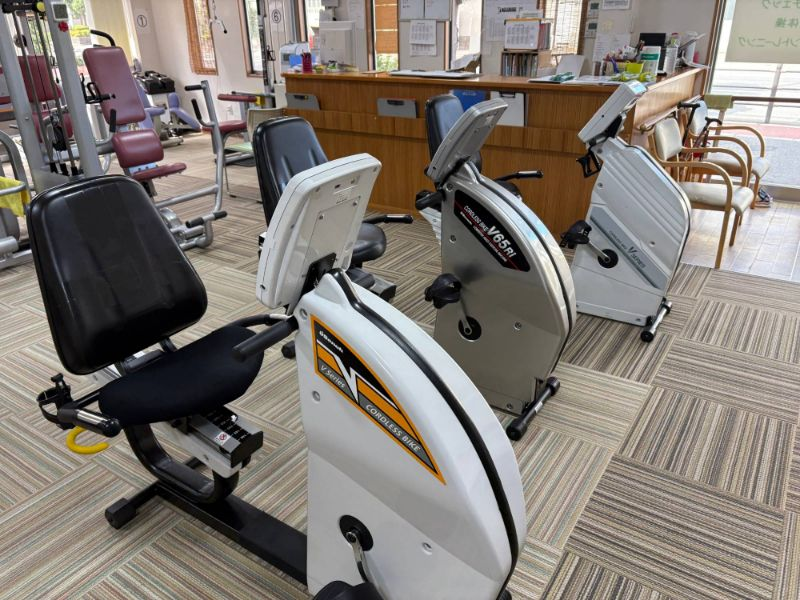

# デイサービス大黒天 公式ホームページ

大阪市大正区の機能訓練特化型デイサービス「デイサービス大黒天」の公式ホームページです。
HTML・CSS・JavaScript だけで作っているので、特別なソフトは要りません。
GitHub Pages や Vercel で、そのまま無料で公開できます。

---

## 1. ファイル構成

```
daikokuten-homepage/
├── index.html          … ホームページの本文（文章・電話番号・住所など）★いちばんよく編集するファイル
├── css/
│   └── style.css       … 見た目（色・文字の大きさ・レイアウト）
├── js/
│   └── main.js         … 動き（スマホメニュー、文字サイズ切替、フォーム送信など）
├── images/
│   ├── hero.svg        … トップのイラスト（hero.jpg を入れると写真に切り替わります）
│   ├── no-image.svg    … 写真が無いときに表示される「写真準備中」の画像
│   ├── favicon.svg     … ロゴマーク・ブラウザのタブに出るアイコン
│   └── equipment/      … 機能訓練機器の写真を入れるフォルダ
│       └── README.md   … 写真のファイル名一覧
├── .nojekyll           … GitHub Pages 用の設定ファイル（消さないでください）
└── README.md           … この説明書
```

## 2. ページの構成（上から順番）

| セクション | 内容 | index.html 内の目印 |
| --- | --- | --- |
| ヘッダー | ロゴ・メニュー・電話番号・文字サイズ切替 | `ヘッダー` |
| トップ | キャッチコピー「いつまでも、自分らしく動ける毎日を。」・4つのポイント・相談ボタン | `トップ（キャッチコピー）` |
| 特徴 | 少人数制／機能訓練中心／短時間型／食事・入浴なし のカード | `デイサービス大黒天の特徴` |
| こんな方におすすめ | 対象となる方のチェックリスト | `対象となる方` |
| 機能訓練・設備 | 12種類の機器（写真＋説明） | `機能訓練・設備` |
| 1日の流れ | 午前の部・午後の部のタイムスケジュール | `1日の流れ` |
| ご利用案内 | 対象者・利用までの流れ・事業所概要・ケアマネジャー向け案内 | `ご利用案内` |
| よくある質問 | Q&A 5問 | `よくある質問` |
| 求人情報 | 仕事内容・働きやすいポイント・問い合わせボタン | `求人情報` |
| お問い合わせ | 電話・住所・営業時間・問い合わせフォーム | `お問い合わせ` |
| アクセス | Googleマップ | `アクセス` |
| フッター | 事業所名・住所・電話番号・メニュー | `フッター` |

---

## 3. 自分のパソコンで表示を確認する

`index.html` をダブルクリックすると、Google Chrome などのブラウザで表示できます。
（地図やフォーム送信はインターネット接続が必要です）

---

## 4. 文章や写真を変更する方法（初心者向け）

### 基本の流れ

1. 変更したいファイル（ほとんどは `index.html`）を開く
   - GitHub のサイト上で編集する場合：ファイルを開き、右上の鉛筆マーク（Edit）をクリック
   - パソコンで編集する場合：「Visual Studio Code」などの無料エディタがおすすめです（メモ帳でも編集できます）
2. 文章を書き換える
3. 保存する（GitHub 上なら「Commit changes」ボタン）
4. 数分後、公開中のホームページに反映されます

> 💡 **編集のコツ**
> `<p>` や `</h3>` のような `< >` で囲まれた部分（タグ）は消さずに、**タグとタグの間の日本語だけ** を書き換えてください。
> `index.html` の中の **「★」マーク** が付いたコメントは、特に書き換えが必要な場所です。
> `Ctrl + F`（Mac は `⌘ + F`）で「★」を検索すると、すぐに見つかります。

### ① 電話番号を入れる（必須）

いまは仮の番号 `06-XXXX-XXXX` が入っています。`index.html` の中に **5か所** あります。

エディタの「置換」機能（`Ctrl + H`／Mac は `⌘ + Option + F`）を使うと一度に変更できます。

| 検索する文字 | 置き換える文字（例） | 説明 |
| --- | --- | --- |
| `06-XXXX-XXXX` | `06-1234-5678` | 画面に表示される番号 |
| `tel:06XXXXXXXX` | `tel:0612345678` | タップで電話をかけるための番号（ハイフンなし） |

### ② 住所を入れる（必須）

いまは仮の住所 `〒551-XXXX 大阪府大阪市大正区○○ X丁目X番X号` が入っています。
`index.html` の中で「**★住所**」を検索すると、**3か所**（お問い合わせ欄・アクセス欄・フッター）が見つかります。
それぞれ正しい住所に書き換えてください。

### ③ 文章を変える

`index.html` を開いて、変えたい文章を探して書き換えるだけです。

例：キャッチコピーを変える場合

```html
<h1 class="hero-title">いつまでも、<br>自分らしく動ける<br>毎日を。</h1>
```

- `<br>` は「改行」の意味です。改行したい位置に入れてください。
- `<br class="pc-only">` は「パソコンのときだけ改行」、`<br class="sp-only">` は「スマホのときだけ改行」です。

### ④ 写真を入れる・変える

写真は **決められた名前で `images` フォルダに入れるだけ** で表示されます。
写真が無いあいだは、自動的に「写真準備中」の画像が表示されます。

| 場所 | 入れるフォルダ | ファイル名 |
| --- | --- | --- |
| トップの大きな写真 | `images/` | `hero.jpg` |
| バイク | `images/equipment/` | `bike.jpg` |
| ヒップアブダクション | `images/equipment/` | `hip-abduction.jpg` |
| レッグプレス | `images/equipment/` | `leg-press.jpg` |
| レッグエクステンション | `images/equipment/` | `leg-extension.jpg` |
| チェストプレス | `images/equipment/` | `chest-press.jpg` |
| フライ | `images/equipment/` | `fly.jpg` |
| ローイング | `images/equipment/` | `rowing.jpg` |
| 上肢滑車 | `images/equipment/` | `pulley.jpg` |
| クランチ | `images/equipment/` | `crunch.jpg` |
| ウォーターベッド | `images/equipment/` | `water-bed.jpg` |
| ドクターメドマー | `images/equipment/` | `medomer.jpg` |
| 低周波電気 | `images/equipment/` | `low-frequency.jpg` |

**GitHub のサイト上で写真を追加する方法**

1. GitHub でリポジトリを開き、`images` →（機器なら）`equipment` フォルダを開く
2. 右上の「Add file」→「Upload files」をクリック
3. 写真をドラッグ＆ドロップ（ファイル名は上の表と同じにしておく）
4. 「Commit changes」をクリック

**写真のポイント**

- ファイル名は **半角・小文字** で、表とまったく同じにしてください（`Bike.JPG` や `bike.jpeg` は表示されません）
- 機器の写真は **横長（横4：縦3）**、トップの写真は **横長（横5：縦4くらい）** がきれいに収まります
- 1枚 **300KB 以下**（横幅 800〜1200px 程度）に縮小すると、表示が速くなります
- 利用者様が写る写真は、必ずご本人・ご家族の **掲載の同意** を取ってください
- `.png` の写真を使いたい場合は、`index.html` の該当する `src="images/equipment/bike.jpg"` の `.jpg` を `.png` に変えてください

### ⑤ 機能訓練機器の説明を変える・追加する

`index.html` の「機能訓練・設備」の中に、機器1台ごとに次のようなまとまりがあります。

```html
<article class="equipment-card">
  <div class="equipment-photo">
    
  </div>
  <div class="equipment-body">
    <h3>バイク</h3>
    <p>座ったままペダルをこぐ有酸素運動です。…</p>
  </div>
</article>
```

- **説明文を変える**：`<p>` と `</p>` の間を書き換えます
- **機器を追加する**：`<article class="equipment-card">` から `</article>` までをコピーして、すぐ下に貼り付け、機器名・説明・写真のファイル名（`src="..."`）・`alt="..."` を書き換えます
- **機器を削除する**：`<article …>` から `</article>` までをまるごと消します

### ⑥ よくある質問を追加する

「よくある質問」の中の `<details class="faq-item" open>` から `</details>` までが質問1つ分です。
コピーして貼り付け、質問と答えを書き換えてください。

### ⑦ 求人の詳しい条件（給与・勤務時間など）を追加する

`index.html` の「求人情報」にある `★給与・勤務時間などの詳しい条件は、ここに追加できます` の位置に、たとえば次のように書き足せます。

```html
<h3 class="box-title">募集要項</h3>
<table class="info-table">
  <tr><th scope="row">雇用形態</th><td>パート</td></tr>
  <tr><th scope="row">給与</th><td>時給 ○○円〜</td></tr>
  <tr><th scope="row">勤務時間</th><td>8:30〜12:30／13:00〜17:00 など</td></tr>
</table>
```

### ⑧ Googleマップを正しい場所にする

いまは仮で「大阪市大正区」全体の地図が出ています。

1. [Googleマップ](https://www.google.com/maps) で事業所の住所を検索
2. 「共有」→「地図を埋め込む」→「HTMLをコピー」をクリック
3. コピーした文字の中の `src="https://www.google.com/maps/embed?pb=……"` の **`"` と `"` の間** だけを取り出す
4. `index.html` の「★Googleマップ」の下にある `<iframe src="……">` の `src="……"` の中身と入れ替える

### ⑨ お問い合わせフォームを使えるようにする

このホームページはサーバーを使わない作りなので、フォームの送信には無料サービス **Formspree（フォームスプリー）** を使います。
設定するまでは、送信ボタンを押すと「フォームは準備中です。お電話でお問い合わせください」と表示されます。

1. [https://formspree.io/](https://formspree.io/) で無料アカウントを作る（届いてほしいメールアドレスで登録）
2. 「New Form」でフォームを作ると、`https://formspree.io/f/abcdwxyz` のような URL が表示される
3. `index.html` で `https://formspree.io/f/XXXXXXXX` を検索し、その URL に置き換える
4. 公開後、実際に一度送信してテストする（最初の1回は Formspree から確認メールが届きます）

フォームから届くメールには「お問い合わせの種類・お名前・電話番号・メールアドレス・お問い合わせ内容」が入ります。

### ⑩ 色を変える

`css/style.css` のいちばん上にある `:root { … }` の中の色コードを変えると、サイト全体の色がまとめて変わります。

```css
--green: #2a7d56;   /* メインの緑（ボタンなど） */
--blue:  #2e6fa3;   /* サブの青（電話ボタンなど） */
```

### ⑪ 文字の大きさを変える

`css/style.css` の `html { font-size: 112.5%; }` の数字を大きくすると、サイト全体の文字が大きくなります（112.5% ＝ 18px）。
閲覧する方は、画面上の「文字を大きくする」ボタンでも大きくできます。

---

## 5. インターネットに公開する方法

### A. GitHub Pages（おすすめ・無料）

1. 作業用ブランチの変更を `main` ブランチにマージ（Pull Request を作って「Merge」）
2. GitHub のリポジトリ画面で **Settings** → 左メニューの **Pages** を開く
3. 「Build and deployment」の **Source** を「Deploy from a branch」にする
4. **Branch** を `main`、フォルダを `/ (root)` にして **Save**
5. 数分後、`https://daydaikoku10-creator.github.io/daikokuten-homepage/` で公開されます

### B. Vercel（無料）

1. [https://vercel.com/](https://vercel.com/) に GitHub アカウントでログイン
2. 「Add New…」→「Project」→ `daikokuten-homepage` を選んで **Import**
3. 設定は何も変えずに **Deploy**
4. 以後は GitHub の `main` ブランチを更新するたびに、自動で公開内容が更新されます

### 独自ドメイン（例：`daikokuten-day.jp`）を使いたい場合

GitHub Pages なら Settings → Pages の「Custom domain」、Vercel なら Project → Settings → Domains から設定できます。

---

## 6. 公開前チェックリスト

- [ ] 電話番号（5か所）を正しい番号にした
- [ ] 住所（3か所）を正しい住所にした
- [ ] 電話の受付時間（「★電話の受付時間」）を確認した
- [ ] Googleマップを事業所の場所にした
- [ ] お問い合わせフォームの送信先（Formspree）を設定し、テスト送信した
- [ ] 機器やトップの写真を入れた（利用者様が写る場合は掲載同意を取った）
- [ ] 送迎の時間・午後の部のスケジュールが実際と合っているか確認した
- [ ] スマートフォンとパソコンの両方で表示を確認した

---

## 7. 技術メモ（詳しい方向け）

- ビルド不要の静的サイト（HTML / CSS / バニラ JavaScript）。外部ライブラリ・Webフォント不使用で軽量
- 画像は `data-fallback` 属性で代替画像を指定（`js/main.js` の 1. を参照）。そのため `main.js` は `<head>` で読み込んでいます
- 機器写真は `loading="lazy"` で遅延読み込み
- よくある質問は `<details>` 要素のため、JavaScript なしで開閉できます
- 文字サイズの切替状態は `localStorage` に保存
- レスポンシブの切り替え幅：600px（タブレット）／900px（PC）／1024px（ヘッダーのメニューを横並びに）
